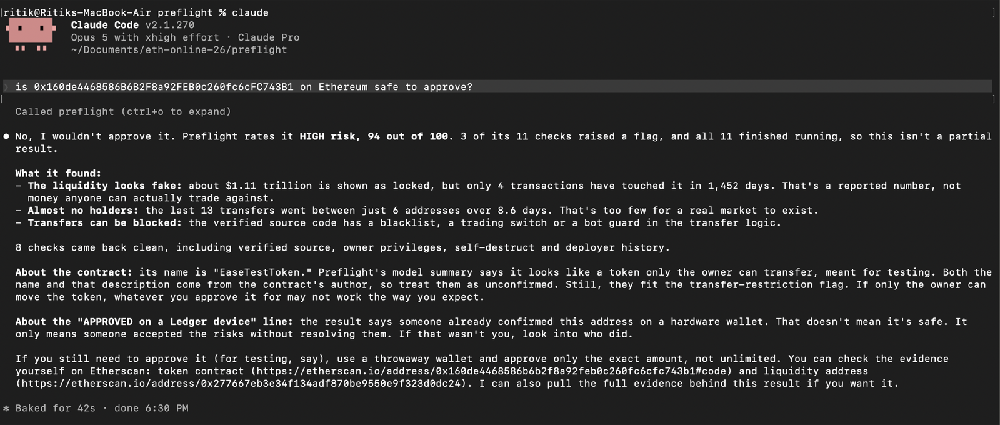

# Preflight

**The check an AI agent clears before it signs.**

Preflight scores a contract on what it has actually done on-chain, not on what its source
code claims. When the verdict is bad, the approval does not resolve in software: it goes to
a Ledger device for a physical press.

It reads Uniswap V3 pool state through The Graph across Ethereum, Arbitrum and Base, and it
ships as an MCP server, so the check happens inside the agent that was about to sign.

---

## ETHGlobal Mumbai 2026: Preflight Capline

**Your agent stays under the line until you've seen the receipts.**

### The problem

AI agents now hold money, and they fail in two ways:

1. **They sign things they shouldn't.** One trading bot lost $7.5M to honeypot contracts in
   June 2026 (Devcon 8, "The $7.5M Sandwich Bot Hack").
2. **They raise their own limits.** "An agent will raise its spending cap without asking the
   human when a task requires more money than the cap allows" (Devcon 8, "Keep your agents
   under control!").

Spend caps exist. What none of them show the owner is what the last money actually bought,
and whether those counterparties were safe. An approval is a number and a yes button.

### What Capline fixes

| Today | With Capline |
|---|---|
| The agent's wallet holds the whole budget; a hijack drains it | The wallet holds one small tranche; the rest sits in `CaplineVault` |
| The agent, or a prompt injection, can raise its own limit | Only the owner's passkey can release more; the agent calling `release` reverts |
| The owner approves a number | The owner sees every payment since the last refill, rebuilt from chain data, each counterparty risk-scored by Preflight |
| The approval screen comes from a server you have to trust | The phone rebuilds what it signs from the chain; the vault rejects anything else |
| A human gate needs a Ledger at a desk | Face ID on the phone, verified onchain (P256), with the Ledger still available for HIGH verdicts |

### Why the receipts can't be faked

**The agent can lie in its reason. It can't lie in its receipts.**

- **The agent never supplies its history.** It sends only an amount and a reason. Receipts are
  rebuilt from onchain transfer logs, starting at the block the vault recorded for the last
  refill, so a hijacked agent cannot hide or invent a payment.
- **You sign what you saw.** The Face ID passkey signs an EIP-712 message that commits to the
  hash of exactly those receipts. The phone recomputes that hash itself, so a server cannot
  show one list and get a signature for another.
- **The contract checks it.** `CaplineVault` verifies the P256 signature onchain and releases
  one tranche. Anything else reverts.
- **The reason is shown, labelled unverified.** Even if the agent lies about what it will do
  next, it can misuse only one small tranche, and the next receipts show exactly where it went.

Chain-verified, not self-reported: the receipts are read by the approval server and every line
links to its transaction; having the phone re-read each transfer itself is on the roadmap.

Preflight checks what your agent touches. Capline, new this weekend, decides whether it gets
more money. The agent's wallet only ever holds one small tranche. When it runs dry, the agent
asks, and the owner's phone shows what the last tranche bought: every payment and fill,
rebuilt from chain data rather than from the agent's own account, each counterparty scored by
Preflight. The owner approves with Face ID, and `CaplineVault` releases the next tranche only
if the passkey signature covers exactly the receipts the owner saw.

```
  AI agent --MCP--> capline_request(amount, reason)
                        |
                        v
  approval server   Receipts: transfer logs (and order fills) since the last release,
                    each counterparty scored by Preflight -> receiptsHash
                    push to the phone (request id only)
                        |
                        v
  owner's phone     Receipts + verdicts + the agent's reason (marked unverified)
  (PWA)             Face ID: passkey signs Release{agent, amount, nonce, expiry, receiptsHash}
                        |   anyone can relay; nobody can alter it
                        v
  CaplineVault      verifies the P256 signature onchain, sends one tranche to the agent
```

If the agent is hijacked, the most it can spend is the tranche it holds. It cannot release
more itself: calling `release` without the owner's signature reverts `BadSignature`.

### Before / during

**Before** (tag `mumbai-2026-start`, commit `a187cf3`, 2026-09-13): Preflight as the rest of
this README describes it. An MCP server that scores contracts on onchain behaviour and sends a
HIGH verdict to a Ledger. Its verdicts were advisory, so a hijacked agent could ignore them,
and the only human gate needed a Ledger at a desk. No contracts, no web app. Earlier
submission: [ETHOnline 2026 showcase](https://ethglobal.com/showcase/preflight-mcp-1i1qm).

**During:** everything in `git diff mumbai-2026-start..HEAD`. The full list, with deployments
and a dated changelog, is in [docs/MUMBAI.md](./docs/MUMBAI.md).

| Piece | Path |
|---|---|
| `CaplineVault`, passkey-gated tranches, 28 forge tests with real P256 signatures | `contracts/` |
| Vault client and EIP-712 types | `packages/capline/` |
| Receipts builder | `packages/receipts/` |
| MCP tools `capline_status`, `capline_request` | `packages/mcp/` |
| Pocket Approve: approval server and phone app | `apps/approve/` |
| Pay-per-call merchant API, settled in Whitechain USDT | `apps/merchant/` |
| Paying agent (Whitechain) and trading agent (Base) | `agents/` |

One fix to the existing engine: market signals now read the most-traded pool instead of the
one with the highest reported value, so priced-up junk pools no longer flag WETH on Base
(HIGH 85 before, CLEAN 0 after).

The interfaces between all of these are in [docs/CAPLINE_SPEC.md](./docs/CAPLINE_SPEC.md).

### Why this needs onchain stablecoin settlement

No card or bank rail lets an owner release money to an autonomous agent in tranches the agent
cannot unlock itself, with a contract (not our server) verifying the owner's signature over
the receipts they saw.

The agent pays the merchant API per call in USDT on Whitechain. The merchant checks the
`Transfer` log itself, and Receipts reads the same log, so the merchant's proof of payment and
the owner's view of the spend are one onchain record. Payments from the agent to the merchant:

- [`0xe9bf9dbd...0aa92`](https://explorer.testnet.whitechain.io/tx/0xe9bf9dbda948a4d226f9f3a0265d2b6f3b64a2b01e67b9eddd08031f88b0aa92)
- [`0xd5b76222...8105c`](https://explorer.testnet.whitechain.io/tx/0xd5b76222a6328b534c84be74e0197f4569675173b85e86e5ed68477f6108105c)

### CROPS

**New property: S (secure), and it is structural.** Before, a hijacked agent could ignore
Preflight. Now spending authority is bounded onchain and only the owner's passkey can extend
it. That does not depend on our server. Switch the approval server off and the agent still
cannot spend past its tranche, because the vault holds the money. The owner can still approve:
the phone app reads vault state from the chain, rebuilds receipts from raw transfer logs
(labelled as having no verdicts), signs with Face ID, and submits the release with a local
gas-only key, or shows the signed payload for anyone to relay.

In plain terms: the phone buzzes, you see what it spent, Face ID.

Tested with the approval server switched off: the phone read the vault from Whitechain, signed
with Face ID and submitted the release from its own gas key,
[released onchain](https://explorer.testnet.whitechain.io/tx/0xd7938f7d28196e3a85e6286ae6db3376a82a76818ebe9ab9dd5b5eed4d3e1078).

- **S:** The passkey's private key never leaves the phone's secure hardware. The vault checks
  the signature with the P256 precompile (present on Whitechain and Base, about 129k gas per
  release). The phone derives the digest from chain state itself, so a hostile server cannot
  get a different release signed. Trust assumptions: the owner's device, and the vault code,
  which is tested but not audited. The agent's key is a hot wallet, bounded to one tranche.
- **C:** We run the approval server (receipts, push, relaying), the ntfy push topic and the
  phone app's host (GitHub Pages). If the server goes away or refuses, the backend-off path
  above still works. Trade-off: a passkey is bound to the domain that created it, and the
  vault has no key rotation yet, so losing that domain would leave funds still in the vault
  unreachable. The agent would keep only its current tranche.
- **O:** MIT. Everything builds and runs from this repo: contracts with Foundry, the rest with
  pnpm. No closed service is required for the vault, the phone app or the agents.
- **P:** No trackers, analytics or third-party scripts in the phone app. Keys stay on the
  device: localStorage holds only public data and a gas-only key that controls no funds. The
  push carries only a request id, never an amount or address. Our server sees requests,
  amounts and agent addresses. Public RPCs and the Whitechain explorer see the addresses the
  phone and the receipts builder read.

### Same vault on Base: a trading agent

The vault is chain-agnostic. On Base, a trading agent runs the same loop with USDC:

1. **Preflight:** `preflight_check` on the token over the Preflight MCP server. WETH comes
   back CLEAN; a HIGH token is never traded.
2. **Tranche:** `capline_request`, and the owner approves 10 USDC from the phone with the same
   passkey. [Released on Base](https://basescan.org/tx/0xe51f0bd3b4b43351d7f49a01c9fee20cce2aae39fd410bb949c260ee5ffbd8bc).
3. **Order:** the agent then places a limit buy with an attached take-profit / stop-loss
   bracket through Definitive Flash, with the bracket width set by the Preflight verdict.
   Order access for our Flash API key was not enabled in time, so no fill is linked and this
   project is not entered for the Definitive prize. The client is in
   [agents/trader-base](agents/trader-base/README.md).

### Prior art

Agent spend caps with human approval are a common pattern in 2026. About ten ETHGlobal
projects are named Leash: Leash Protocol, LEASH Agent Guard, LeashGuard, Re:Leash, Leash,
Leash_dash, Leash Layer, Leashh and Leash AI. DSAP Protocol pairs spending limits with World ID
approval, Quorly approves with your face, and Held escrows x402 payments until the buyer
reviews what they bought.

Those ask how much the agent may spend and whether a human clicked yes. Capline asks what the
last money touched and whether it was safe:

- **Risk-scored receipts.** Each past payment and fill carries Preflight's verdict on its
  counterparty, from onchain history rather than source code.
- **Rebuilt from the chain.** Receipts come from transfer logs and fills, not from the agent,
  so a hijacked agent cannot rewrite its history.
- **The owner signs what they saw.** The approval digest commits to `receiptsHash`, so a
  release is bound to the exact list on the screen.

### Contracts

| Contract | Chain | Address |
|---|---|---|
| CaplineVault (verified) | Whitechain Sepolia, 1874 | [`0x31529ef8ec96f7a1bc5ea0166b3c040b1b95bbee`](https://explorer.testnet.whitechain.io/address/0x31529ef8ec96f7a1bc5ea0166b3c040b1b95bbee) |
| PartnerSink (demo "partner", unverified on purpose) | Whitechain Sepolia, 1874 | [`0x4FECAE863ef2A0c64e211336C2bFCc822165c98a`](https://explorer.testnet.whitechain.io/address/0x4FECAE863ef2A0c64e211336C2bFCc822165c98a) |
| CaplineVault (verified, Sourcify) | Base, 8453 | [`0x25d1946ee739e53160be890fbec9a2c66fc61799`](https://basescan.org/address/0x25d1946ee739e53160be890fbec9a2c66fc61799) |

PartnerSink is the contract a hijacked agent gets tricked into paying. Preflight scores it
HIGH: "unverified contract, deployed 1 min ago".

End-to-end run on Whitechain (`pnpm test:e2e`, software P256 key signing through the phone
app's own WebAuthn code):
[release relayed by the server](https://explorer.testnet.whitechain.io/tx/0xbc803bbee0b1cd530b9061737e0c2191f28c31fcb0a983fa8e4b536c90eabcaf).
The same run sends a replayed signature, an agent releasing to itself, and a release while
dropped; all three revert onchain.

From a real iPhone: Face ID approval of a 5 USDT refill after three paid API calls, with the
receipts on screen,
[released onchain](https://explorer.testnet.whitechain.io/tx/0x6407088ce5c0d09665072b1ee460dc7f52189f8e3860ad8be0780d863aebcce1).

### Run it

```bash
pnpm install
cp .env.example .env                       # Capline variables: docs/CAPLINE_SPEC.md
(cd contracts && forge test -vv)           # vault tests, real P256 signatures
pnpm test

# owner side: phone app on GitHub Pages, approval server behind a tunnel
scripts/deploy-approve.sh
scripts/tunnel-approve.sh

# paying agent on Whitechain
pnpm --filter @preflight/merchant evil                    # API with a prompt injection
pnpm --filter @preflight/payer-whitechain scripted        # pays, then asks for 500
pnpm --filter @preflight/payer-whitechain self-release    # reverts BadSignature

# trading agent on Base
pnpm --filter @preflight/trader-base dry-run              # prints Flash requests, sends none
pnpm --filter @preflight/trader-base start                # spends real USDC
```

Deploy, verify and register commands: [contracts/README.md](contracts/README.md).

### Current limitations

- No real users. This is a hackathon build with demo agents.
- The Base trading agent stops before its order: Flash order access was not enabled for our key.
- On Whitechain, Preflight has no Uniswap subgraph, so counterparties are scored from RPC and
  explorer checks (code, age, verified source, deployer) instead of the full engine.
- Risk-triggered escalation under budget and gasless agent payments are planned, not built.

### What comes next

- **One-line setup.** `claude mcp add preflight` already brings the Capline tools. Next, the
  first `capline_request` prints a QR code; the owner scans it, Face ID creates the passkey and
  approves the first budget, and that registers the agent. No server or tunnel to run.
- **Native web push.** Notifications go through ntfy today (open source, self-hostable, the
  push carries only a request id). The phone app can receive standard Web Push itself once
  added to the home screen, which removes the extra app.
- **Hosted relay with the same trust model.** The phone checks everything it signs and can
  submit straight to the chain, so a hosted relay is a convenience, never a custodian.

---

## The boundary nobody was defending

An autonomous agent crosses five boundaries. Each is a place something can go wrong.

| Boundary | What crosses it | Defended by |
|---|---|---|
| Supply chain | What the agent installs | npmguard |
| **Ingestion** | **What the agent reads** | **nobody** |
| Discovery | What the agent trusts | Proof of Scan |
| Signing | What the agent submits | ENShell |
| Authority | What the agent may do | maki |

Look at the agent-security projects that have won at recent events and four of those five have
somebody on them. The one that does not is what the agent reads, and it is the cheapest of the
five to attack.

**Everything an agent reads on-chain was written by whoever deployed the contract, for the price
of gas.** Token names, symbols, the verified source, the ABI function names. That text goes
straight into the context window of something holding a private key.

### What that looks like in practice

Here is a real token on Ethereum mainnet. It reports **1.1 trillion dollars of liquidity**. Four
transactions have touched it in four years. The source is verified and the name is friendly, so
an agent reading the contract finds nothing wrong and signs.



Notice what the agent does with the contract's own name. It reports that the name and the model's
description "come from the contract's author, so treat them as unconfirmed". And it reads the
hardware approval for what it is: "that doesn't mean it's safe, it only means someone accepted
the risks without resolving them."

Source code tells you what a contract may do. Indexed pool history tells you what it has done,
and only one of those predicts a rug.

---

## How it works

```
  AGENT  (Claude Code, Cursor)  holds signing capability
    |
    |  preflight_check { address, chainId }
    v
  packages/mcp          three tools over stdio
    |
    v
  packages/engine       one definition of a verdict
    |
    +---> packages/analysis   Etherscan V2: source, ABI, proxy, deployer, transfers
    +---> packages/signals    The Graph: Uniswap V3 pools on 3 chains
    |                         11 weighted signals
    +---> packages/core       score() - deterministic, no model
    |
    +---> packages/quarantine untrusted strings sealed and nonce-delimited
    |
    +---> packages/gate       HIGH -> Ledger device, physical press required
    |
    v
  verdict -> Postgres, and text back to the agent
```

Three trust boundaries, what crosses each and how it fails, plus the scoring formula and every
weight, are in [docs/ARCHITECTURE.md](./docs/ARCHITECTURE.md).

---

## What existed before ETHOnline 2026

**Base project:** Inspector AI, built at ETHGlobal Singapore, September 2024.
**Repository:** https://github.com/Krane-Apps/inspector-ai-eth-singapore-2024
**Base commit:** `b9737ffde8c0e599a1187e815fcba9cf4642423d` (2024-09-22)
**Prize:** Worldcoin pool prize.

Inspector AI was a **team project**. Original contributors: Ritik Lakhwani, Ishan Lakhwani,
resatu. Verify with `git log` in the base repository.

It was a Chrome extension. A human pasted a contract address, the extension fetched source
and ABI from Etherscan plus market data from 1inch, sent both to a model, and displayed a
High / Moderate / Low risk label alongside community reviews.

### Reused from 2024

| What | Where it lives now |
|---|---|
| Etherscan source + ABI fetch | `packages/analysis/src/etherscan.ts` |
| The LLM review prompt and its analytical structure | `packages/analysis/src/llm.ts` |
| The risk taxonomy: High Risk / Moderate Risk / Low Risk | `packages/analysis/src/llm.ts` |

Every ported file carries a header comment naming the original file and line range.

### Not revived, documented in [LEGACY.md](./LEGACY.md)

The Chrome extension UI, the GaiaNet LLAMA 3.1 model (endpoint dead), the 1inch proxy
(Replit app no longer running), the community review system, the NFT rewards, CCIP
cross-chain review aggregation.

---

## What was built during ETHOnline 2026

Everything after the `ethonline-2026-start` tag:

```bash
git diff ethonline-2026-start..HEAD
```

| Package | Origin | State | What it does |
|---|---|---|---|
| `packages/core` | NEW | shipped | Shared types and the deterministic scoring function |
| `packages/analysis` | PORTED + extended | shipped | Etherscan fetch and LLM review from 2024, plus **new** deterministic structural checks and proxy implementation resolution |
| `packages/signals` | NEW | shipped | Eleven weighted signals. Four read the contract, seven read Uniswap V3 market history through The Graph and the deployer's own history |
| `packages/engine` | NEW | shipped | Composes analysis, signals and scoring into one verdict, and persists it |
| `packages/mcp` | NEW | shipped | The MCP server an agent installs. Three tools, with untrusted on-chain strings delimited before they reach a model |
| `packages/quarantine` | NEW | shipped | Injection detection on untrusted on-chain strings, and prompt spotlighting before a model reads contract source |
| `packages/gate` | NEW | shipped | Ledger device confirmation in front of a `high` verdict, and `wallet-cli ring` as the credential store for the keys this repo used to hold in plaintext |
| `packages/console` | NEW | cut | A verdict dashboard was planned and dropped. The MCP client is the product surface, and nothing in the project depends on a second one |

This table is updated as packages land, so what it claims and what runs stay the same thing.

---

## Why the 2024 premise no longer holds

Inspector AI assumed a human clicked "AI Audit" before approving. That assumption is dead,
and not because the analysis got worse. It is dead because **the human is frequently no
longer in the signing loop.** Agents read contracts and sign transactions autonomously, and
nothing sits between the decision and an irreversible approval.

Two consequences drove this rebuild:

**Source code is the weaker signal.** What predicts a rug is behaviour: who deployed this,
what did that deployer ship before, is the liquidity real. Source analysis answers none of
that. Indexed on-chain data does.

**The data the agent reads is itself attacker-controlled.** Token names, symbols, ENS text
records, NFT metadata. Anyone can write anything into those fields for the price of gas, and
it lands directly in the model's context. That channel is unauthenticated, permanently
hosted, and unguarded.

---

## Setup

```bash
cp .env.example .env    # fill in the keys
pnpm install
pnpm db:up && pnpm db:init          # optional; without it verdicts stay in memory
pnpm analyse 0x6B175474E89094C44Da98b954EedeAC495271d0F
```

Then run it the way an agent does:

```bash
node --env-file=.env --import tsx scripts/mcp-smoke.ts 0xA0b86991c6218b36c1d19D4a2e9Eb0cE3606eB48
```

To install it into Claude Desktop or Cursor, see [SKILL.md](./SKILL.md).

### Chain coverage

Ethereum, Arbitrum and Base. One query shape runs against all three, since
Uniswap deploys identical subgraph code per chain and only the subgraph id
changes.

Coverage on Base is partial, and by billing rather than by bug: Etherscan's free
tier serves contract source there but not creation records, so `not-a-contract`
and `deployer-history` cannot run and report so. The verdict is computed from
the seven checks that did complete, and the response says which ones did not.
When fewer than 60% of checks complete, Preflight returns an error instead of a
verdict rather than let an outage read as a clean bill of health.

### Where The Graph integration lives

The Graph is where Preflight learns what a contract has **done**, as opposed to what its source
says it will do. A node can tell you a token's balance. It cannot tell you that the only pool
holding it was created six hours ago and has never been traded. That needs indexed history.

**Seven of the eleven signals depend on it.** Remove The Graph and the project cannot answer its
own question.

We read the official Uniswap V3 subgraphs through the decentralised gateway, authenticated with
a Subgraph Studio key. Uniswap ships identical subgraph code to each chain, so one query string
covers all three and only the deployment id changes.

| Chain | Subgraph deployment id |
|---|---|
| Ethereum, 1 | `5zvR82QoaXYFyDEKLZ9t6v9adgnptxYpKpSbxtgVENFV` |
| Arbitrum One, 42161 | `FbCGRftH4a3yZugY7TnbYgPJVEv2LvMT6oF1fxPe9aJM` |
| Base, 8453 | `HMuAwufqZ1YCRmzL2SfHTVkzZovC9VL2UAKhjvRqKiR1` |

| What | Where |
|---|---|
| Chain to deployment mapping | [`graph.ts:30-34`](packages/signals/src/graph.ts#L30-L34) |
| The gateway call, with the Studio key | [`graph.ts:219-244`](packages/signals/src/graph.ts#L219-L244) |
| Both directional pool queries | [`graph.ts:161-173`](packages/signals/src/graph.ts#L161-L173) |
| The signals that read it | [`behavioural.ts`](packages/signals/src/behavioural.ts) |

Endpoint shape: `https://gateway.thegraph.com/api/{KEY}/subgraphs/id/{ID}`

Live data only. No fixture or cached response ever reaches a verdict. When the gateway fails,
the four market signals report an error rather than reporting "this token has no market", because
a gap in our knowledge and a finding about the token are different things.

Developer feedback for The Graph's data is in [FEEDBACK.md](./FEEDBACK.md), which documents three
V3 subgraph fields that return plausible wrong answers. One of them became
[a fix upstream](https://github.com/Uniswap/v3-subgraph/pull/310).

### Where the Ledger integration lives

Two things, both named directions in Ledger's Continuity track.

**A device confirmation in front of an action that previously had none.** A `high`
verdict used to print a policy line that nothing enforced. Now `preflight_check`
calls `packages/gate`, which asks a Ledger device to display something on its own
screen, and returns a refusal unless a person presses the button.

The property worth testing: unplug the device and the flow breaks. It does not
degrade, warn, or proceed with a note. `preflight_check` returns an error and the
agent is told not to sign.

Every path that is not an explicit approval is a refusal: no device, no
`wallet-cli`, a timeout, a crash, unparseable output. See
[`packages/gate/src/device.ts`](packages/gate/src/device.ts).

**What the press proves, stated exactly.** The device displays an address and a
person confirms it, so the press is evidence that a human was physically at the
Ledger and consented at that moment. It is a proof of presence, not a signature
over the transaction, and it does not bind the approval to specific calldata.
Binding it would mean signing something structured, which needs gas and may need
blind signing enabled: two more things to fail, on a check that runs before any
transaction exists. Preflight signs nothing and holds no keys. It decides whether
something else is allowed to, and for that a human at the device is the property
worth enforcing.

An approval is also not a clean bill of health. The verdict still reads HIGH and
the findings still stand; the output says so. What changed is that a person saw
them and chose to accept them.

**`wallet-cli ring` as the key backend for the `.env` this repo already had.**
API keys are encrypted against the Key Ring, committed as ciphertext in
[`secrets/`](secrets/README.md), and decrypted at runtime. Neither encrypting nor
decrypting needs the device: `ring init` provisions the trustchain once with the
Ledger attached, and everything after runs against local member credentials.
That is what makes it usable on a server.

The passphrase comes from the OS keychain, injected by `bin/preflight-mcp` at
spawn, because wallet-cli refuses to prompt without a TTY and an MCP server
never has one. It is never written to a file and never appears in the client
configuration.

```
PREFLIGHT_GATE=off       skip the device. Records the verdict as not approved by a
                         human rather than as approved, because nobody pressed anything.
GATE_TIMEOUT_MS          how long someone has to press once a device is known to be
                         attached. Default 40000.
PREFLIGHT_SKIP_USB_PROBE disable the presence check and let wallet-cli discover the
                         device itself, which takes about a minute when there is none.
```

Neither `wallet-cli receive --verify` nor `genuine-check` fails fast with no device
attached: both scan for roughly a minute, measured at 61 and 62 seconds. The whole
`preflight_check` call has to finish inside the MCP client's 60 second request
timeout, and the analysis ahead of the gate already spends about twelve, so waiting
out that scan left under a second of margin. `deviceAttached()` reads the USB tree in
about 47 milliseconds instead. Absent means refuse now and say so; present means there
is budget to wait for a person.

The wait itself is not a fixed number. The MCP client gives a tool call sixty
seconds, analysis spends a variable part of that, and the gate is handed only
what is left. Adding a constant wait to a variable analysis is how a call ends
up exceeding its caller's limit, and when that happens the agent receives a
transport timeout rather than a refusal. A timeout is not an answer. Etherscan
calls are bounded at eight seconds each and the advisory model at fifteen with
retries disabled, so no upstream stall can spend the budget either.

### Where the Uniswap integration lives

Preflight deploys no contracts. It reads Uniswap V3 pool state and turns it into a risk
verdict, so the integration is in the query layer and the signals rather than in an SDK
call. For verification:

| What | Where |
|---|---|
| Chain-to-deployment mapping, the three subgraph ids | [`graph.ts:30-34`](packages/signals/src/graph.ts#L30-L34) |
| The two pool queries, both sides of the pair | [`graph.ts:161-173`](packages/signals/src/graph.ts#L161-L173) |
| The gateway call, authenticated with a Subgraph Studio key | [`graph.ts:219-244`](packages/signals/src/graph.ts#L219-L244) |
| `no-market`: no V3 pool on either side of the pair | [`behavioural.ts:118`](packages/signals/src/behavioural.ts#L118) |
| `pool-age`: `createdAtTimestamp` on the deepest pool | [`behavioural.ts:167`](packages/signals/src/behavioural.ts#L167) |
| `liquidity-reality`: value locked against transaction count | [`behavioural.ts:230`](packages/signals/src/behavioural.ts#L230) |
| `thin-liquidity`: whether a swap can be executed here at all | [`behavioural.ts:317`](packages/signals/src/behavioural.ts#L317) |
| How the thresholds were calibrated against real pools | [`docs/verifying-weights.md`](docs/verifying-weights.md) |
| Labelled addresses and the verdicts they produce | [`test/benchmark/addresses.json`](test/benchmark/addresses.json) |

Developer feedback for the Uniswap team is in [FEEDBACK.md](./FEEDBACK.md). Feedback for
Ledger is in [docs/feedback-ledger.md](docs/feedback-ledger.md).

### Verifying the risk model

The weights are a claim about how much each finding matters on its own. See
[docs/verifying-weights.md](./docs/verifying-weights.md) for how to check them,
plus `scripts/weights.ts` and `scripts/benchmark.ts`.

### Checking it yourself

| Document | What it is for |
|---|---|
| [docs/TEST-PLAN.md](./docs/TEST-PLAN.md) | Every case worth trying, including the hardware ones: device locked, unplugged mid-wait, rejected on the device. Exact commands and exact expected output |
| [docs/ARCHITECTURE.md](./docs/ARCHITECTURE.md) | How it works in plain language, the trust boundaries, how the score is computed, and what each partner integration does and where |

## AI tool usage

See [AI_DISCLOSURE.md](./AI_DISCLOSURE.md).
